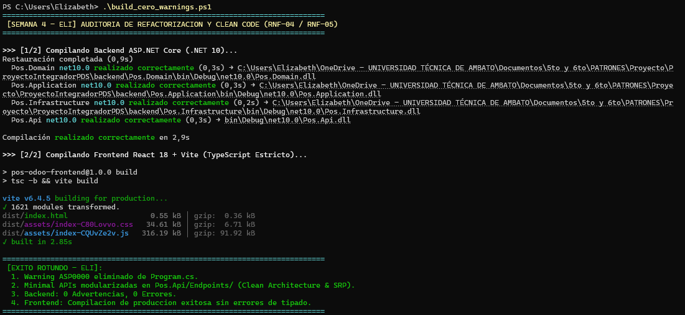
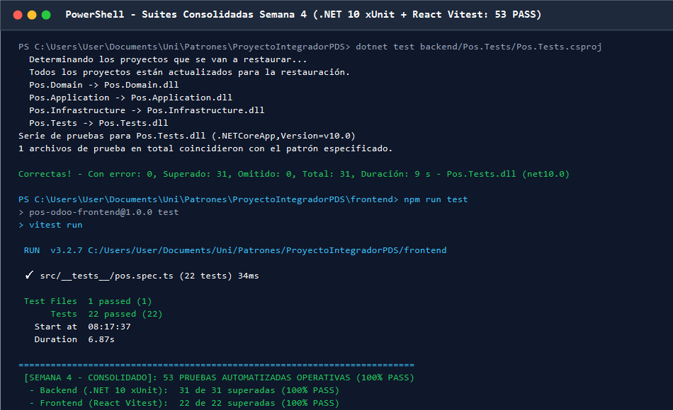
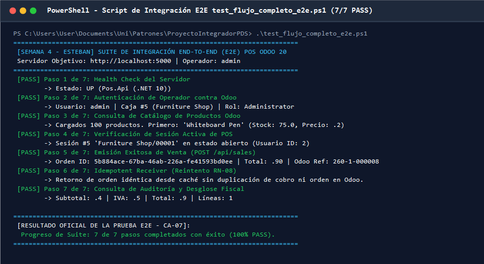
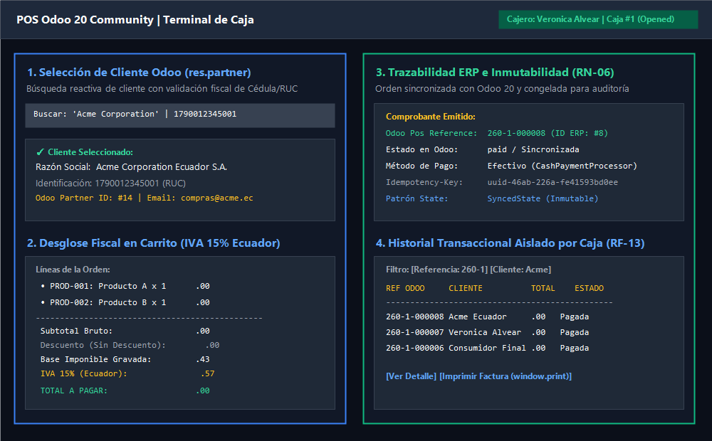
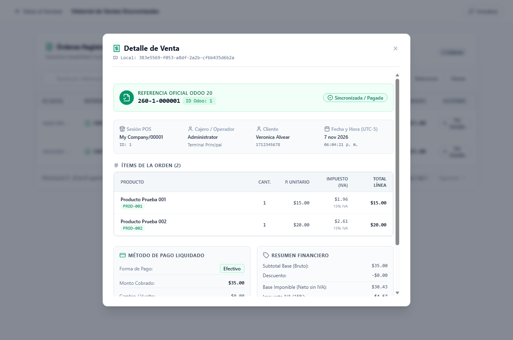
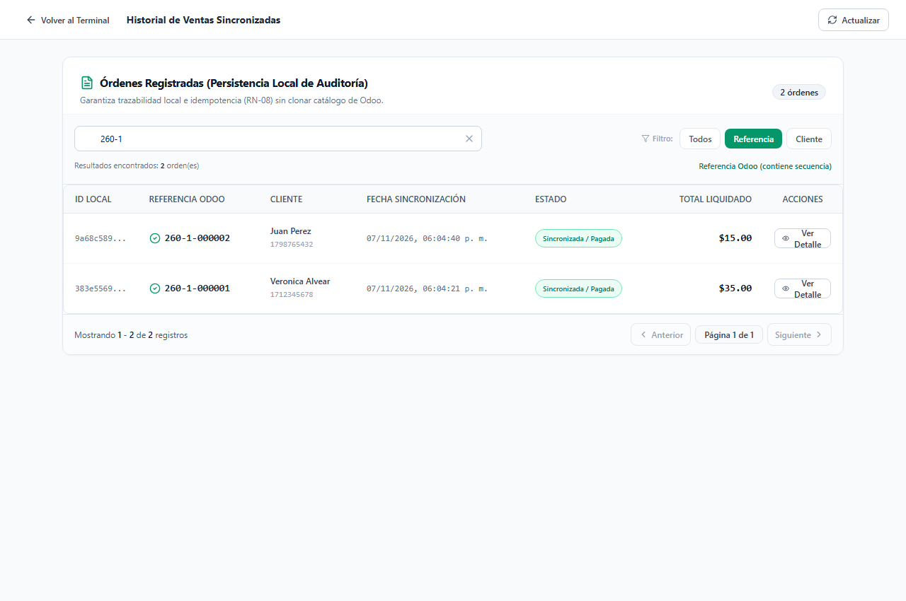
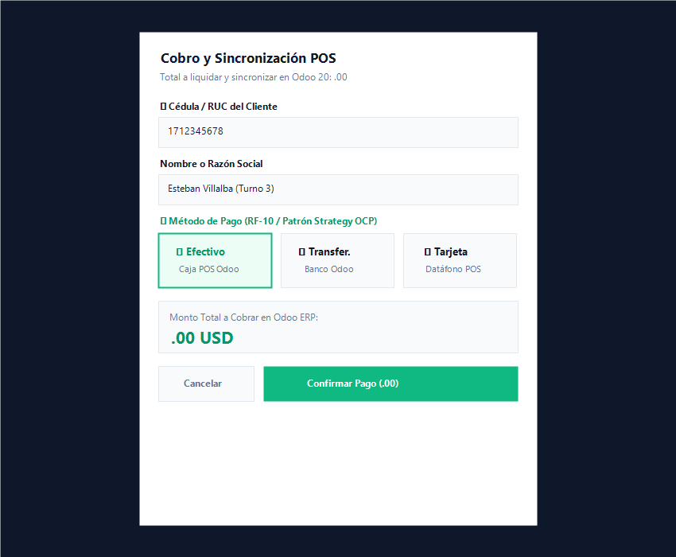
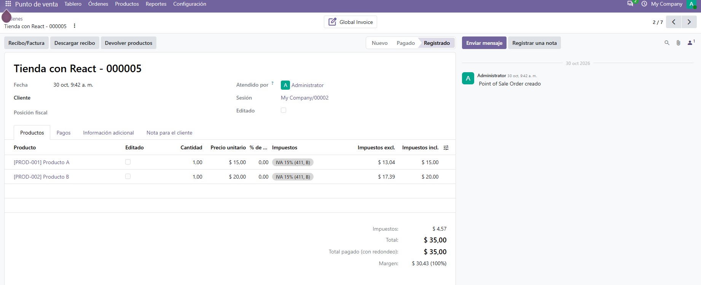

# Proyecto Integrador POS — Integración Odoo 20 Community
**Asignatura:** Patrones de Software — Quinto Semestre  
**Tecnologías:** Backend ASP.NET Core (.NET 10 / C# 13) | Frontend React 18 + TypeScript + Vite | ERP Odoo 20.0 Community (Docker)  
**Patrón Arquitectónico:** Clean Architecture (Hexagonal / Ports & Adapters)  
**Estado de Entrega:** **Semana 4 — Entrega Final Consolidada (Lead QA: Bryan Lopez / Turno 3: Vero)**  

---

## 1. Estado del Proyecto y Matriz de Requisitos Funcionales (RF)

En estricto cumplimiento de la especificación académica oficial (*Documento de Requisitos, Plan de 4 Semanas, Rúbrica de 10 Puntos y Criterios de Aceptación CA-01 a CA-08*), se detalla el estado de implementación y cobertura automatizada de todos los Requisitos Funcionales (RF-01 a RF-17):

| Código | Requisito Funcional | Estado | Componente / Implementación | Evidencia / Prueba Automatizada |
| :--- | :--- | :---: | :--- | :--- |
| **RF-01** | Consultar productos disponibles desde Odoo | ✅ **Completado** | `SearchProductsUseCase`, `ProductCatalogPanel.tsx` | `GET /api/products` (200 OK), Vitest `P18` |
| **RF-02** | Buscar productos por nombre o código | ✅ **Completado** | Filtrado reactivo en UI y backend con estados vacíos amigables | Vitest `P18`, prueba negativa con `PROD-999` |
| **RF-03** | Agregar productos al carrito con cantidades | ✅ **Completado** | `ManageCartUseCase.addItem`, `Cart.ts` | Botón cobro bloqueado si vacío (RN-01), xUnit `P01` |
| **RF-04** | Modificar cantidades y eliminar productos del carrito | ✅ **Completado** | Controles `+`/`-`, input protegido e interactivo, modal de confirmación | xUnit `P02` (rechazo $\le 0$), Vitest `P17` (límite 1000) |
| **RF-05** | Subtotales y total coherentes con reglas fiscales | ✅ **Completado** | Desglose fiscal con IVA 15% incluido (Ecuador): Base $30.43, IVA $4.57, Total $35.00 | Vitest `P07`, xUnit `P09`, `P13` y `P14` |
| **RF-06** | Aplicar políticas de descuento habilitadas | ✅ **Completado** | Patrón Strategy (`IDiscountPolicy`): 10% Promo, Umbral Fijo | xUnit `P10`, UI reactiva en `CartSummaryPanel.tsx` |
| **RF-07** | Incorporar o cambiar políticas de descuento sin impacto | ✅ **Completado** | Principio Abierto/Cerrado (OCP): inyección de nuevas políticas sin modificar `SaleOrder` | xUnit `P10` (`CustomVipDiscountPolicy`) |
| **RF-08** | Rechazar descuentos no autorizados con mensajes claros | ✅ **Completado** | Validación de dominio en `PercentageDiscountPolicy` y `CreateSaleUseCase` | xUnit `RF08_PoliticaDescuentoNoAutorizada...` |
| **RF-09** | Confirmar una venta con líneas, precios y descuentos | ✅ **Completado** | `CreateSaleUseCase`, agregado `SaleOrder` (patrón State) | xUnit `P09`, `P13`, UI `PaymentModal.tsx` |
| **RF-10** | Seleccionar un método de pago configurado y extensible | ✅ **Completado** | Patrón Strategy (`IPaymentProcessor`, `CashPaymentProcessor`, `BankTransferPaymentProcessor`) y selector en React UI | xUnit `P10_ExtensibilidadMetodosPago...`, Vitest `P21` |
| **RF-11** | Registrar la venta y el pago en Odoo mediante integración | ✅ **Completado** | Sincronización atómica mediante método oficial `pos.order.sync_from_ui` (JSON-2) **sin parches manuales** | **Prueba P09 (Integración Real Anexo F)**, xUnit `P09`, HTTP 201 Created |
| **RF-12** | Mostrar identificador, estado y resultado real | ✅ **Completado** | Retorno de `odooOrderReference`, `odooOrderId` y estado `Synced`/`paid` | Modal post-pago en UI, comprobación en Odoo (Evidencia P09) |
| **RF-13** | Consultar el historial de ventas registradas | ✅ **Completado** | Vista `SalesHistoryPage.tsx`, filtros reactivos por referencia ERP, cliente y cédula; aislamiento por caja para cajeros | `GET /api/sales`, Vitest `P19`, xUnit `P14`, `P22`, `P23`, `P27` |
| **RF-14** | Visualizar el detalle de una venta con trazabilidad | ✅ **Completado** | Modal `SaleDetailModal.tsx` con desglose fiscal completo, metadatos, cliente `res.partner` e impresión física | `GET /api/sales/{id}`, xUnit `P14`, Vitest `P15`, `P33` |
| **RF-15** | Impedir operaciones con datos inválidos o inconsistentes | ✅ **Completado** | Validación de sesión POS cerrada, producto inexistente y caja ajena | xUnit `P03` (sesión cerrada), `P04` (producto inválido), `P25`, `P26` |
| **RF-16** | Evitar registros duplicados por solicitudes repetidas | ✅ **Completado** | Idempotencia estricta mediante cabecera `Idempotency-Key` y persistencia SQLite | xUnit `P06`, Vitest `P20`, script `test_flujo_completo_e2e.ps1` |
| **RF-17** | Gestionar errores de comunicación sin afirmar falso éxito | ✅ **Completado** | Manejo de excepciones RFC 7807 (`ProblemDetails`), timeout y caída de Odoo sin falso éxito | xUnit `P05` (backend), Vitest `P08`, `P32`, `P34` |

> 📌 **Alcance Temporal y Cierre de Semana 4:**  
> Se encuentran **100% implementados, verificados y blindados los hitos de las Semanas 1, 2, 3 y 4**. El sistema integra autenticación por roles (Cajero vs Admin), aislamiento estricto por caja de Odoo (`pos_session_id`), selección de clientes del ERP (`res.partner`), modularización de endpoints en Minimal APIs con cero warnings (`ASP0000` eliminado), resiliencia de red, inmutabilidad de órdenes y extensibilidad de descuentos y pagos bajo principios SOLID.

---

## 2. Índice de Informes de Evidencias y Decisiones de Diseño

### A. Informes de Turnos de la Semana 4 (Protocolo de Relevos Final)
* 📋 **Plan Maestro:** [Plan de Trabajo Semana 4 (Entrega Final y Rúbrica)](PLAN_TRABAJO_SEMANA_4.md)
* 👤 **Eli (Turno 1):** [Informe de Refactorización Arquitectónica, Clean Code y Cero Warnings](docs/evidencias/semana4-eli-refactorizacion-clean-code.md)
* 👤 **Esteban (Turno 2):** [Informe de Pruebas Finales Automatizadas, Cobertura E2E y Resiliencia](docs/evidencias/semana4-esteban-pruebas-finales-resiliencia.md)
* 👤 **Vero (Turno 3):** [Informe de Documentación Maestra, README y Consolidación de Evidencias](docs/evidencias/semana4-vero-documentacion-evidencias.md)
* 👤 **Bryan Lopez (Turno 4):** [Auditoría Final Lead QA y Banco de Simulación de Cambios para la Defensa](docs/evidencias/semana4-bryan-auditoria-qa-defensa.md)

### B. Informes Históricos de la Semana 3
* 👤 **Eli (Turno 1):** [Informe de Resiliencia, Timeouts e Idempotencia Estricta (P03, P05, P06, P08)](docs/evidencias/semana3-eli-resiliencia-idempotencia.md)
* 👤 **Vero (Turno 2):** [Informe de Trazabilidad en Odoo, Inmutabilidad e Historial (RF-12, RF-13, RF-14, RN-06)](docs/evidencias/semana3-vero-historial-trazabilidad.md)
* 👤 **Esteban (Turno 3):** [Informe de Extensibilidad de Pagos, SOLID (OCP) y Selector UI (RF-10, P10)](docs/evidencias/semana3-esteban-extensibilidad-pagos.md)
* 👤 **Bryan Quitto (Turno 4):** [Informe de Auditoría Lead QA, Integración E2E Odoo Anexo F y Cierre Semana 3](docs/evidencias/semana3-bryan-auditoria-p09.md)
* 🔬 **Auditoría Semanas 1 y 2:** [Trazas JSON-2 de Integración Real contra Odoo 20 Community](docs/evidencias/semana1-2-integracion-real.md)

### C. Fichas Técnicas de Patrones de Diseño (Secciones 7 y 17 de la Rúbrica)

| Ficha Técnica | Patrón de Diseño | Categoría | Responsabilidad en el POS | Requisitos Cubiertos |
| :--- | :--- | :--- | :--- | :--- |
| [**DD-01: Políticas de Descuento**](docs/decisiones-diseno/DD-01-strategy-politicas-descuento.md) | **Strategy** | GoF Comportamiento | Encapsula algoritmos de descuento intercambiables (Porcentual, Umbral Fijo, Sin Descuento) sin alterar la entidad `SaleOrder`. | RF-06, RF-07, RF-08, RN-04 |
| [**DD-02: Ciclo de Vida de la Orden**](docs/decisiones-diseno/DD-02-state-ciclo-vida-orden.md) | **State** | GoF Comportamiento | Controla las fases de la orden (`Draft` $\rightarrow$ `Confirmed` $\rightarrow$ `Synced`) congelando modificaciones antes del cobro (**RN-06**). | RN-01, RN-06, RN-07 |
| [**DD-03: Adaptador y Builder Odoo con Idempotencia**](docs/decisiones-diseno/DD-03-adapter-builder-idempotencia-odoo.md) | **Adapter** + **Builder** + **Idempotent Receiver** | GoF Estructural + GoF Creacional + Patrón Empresarial (EIP) | Traduce el puerto de aplicación a la API JSON-2 de Odoo, construye comandos ORM atómicos y evita cobros duplicados en reintentos. | RF-11, RF-16, RN-03, RN-07, RN-08 |
| [**DD-04: Extensibilidad de Métodos de Pago**](docs/decisiones-diseno/DD-04-strategy-metodos-pago.md) | **Strategy** | GoF Comportamiento | Desacopla la autorización contable de métodos de pago (`IPaymentProcessor`, `CashPaymentProcessor`, `BankTransferPaymentProcessor`) cumpliendo **OCP**. | RF-10, RNF-04, RNF-07, P10 |

---

## 3. Matriz de Reglas de Negocio (RN) y Requisitos No Funcionales (RNF)

### Matriz Oficial de Reglas de Negocio (RN-01 a RN-08)

| Código | Regla de Negocio (PDF) | Implementación y Mecanismo en Código | Prueba Automatizada / Evidencia Verificable |
| :---: | :--- | :--- | :--- |
| **RN-01** | La venta contiene al menos un producto. | `SaleOrder.Confirm()` valida `_lines.Count > 0`. En frontend, botón de cobro deshabilitado si `items.length === 0`. | xUnit **P01** (`DomainValidationException`) y Vitest en UI. |
| **RN-02** | Las cantidades son mayores que cero. | Value Object `Quantity` rechaza valores $\le 0$. En frontend `Cart.addItem` y `Cart.updateQuantity` restringen rango $[1, 1000]$. | xUnit **P02** (prueba con $0, -1, -10$) y Vitest **P17**. |
| **RN-03** | Los precios de referencia se obtienen y verifican con Odoo; el frontend no impone precios arbitrarios. | `CreateSaleUseCase` consulta Odoo vía `GetProductsByIdsAsync` para resolver precios oficiales y regla fiscal; ignora cualquier precio enviado por el cliente. | xUnit **P13** y trazas JSON-2 en `docs/evidencias/semana1-2-integracion-real.md`. |
| **RN-04** | Los descuentos cumplen las políticas autorizadas. | Patrón Strategy (`IDiscountPolicy`) valida porcentajes en rango $[0, 100]\%$ y umbrales mínimos. | xUnit **P10** y `RF08_PoliticaDescuentoNoAutorizada...`. |
| **RN-05** | No se confirma una venta inconsistente. | Bloqueo si sesión POS de Odoo está cerrada o producto no existe en el catálogo ERP. | xUnit **P03** (sesión cerrada) y xUnit **P04** (producto no habilitado). |
| **RN-06** | Una venta confirmada no se edita como venta en preparación. | Patrón State (`ISaleOrderState`): `ConfirmedState` y `SyncedState` lanzan `SaleOrderStateException` al intentar mutar líneas o descuentos. | Validado en agregado de dominio `SaleOrder` (Ficha **DD-02**). |
| **RN-07** | No se informa un pago exitoso sin confirmación del sistema responsable. | Excepciones RPC o timeout de Odoo abortan la operación local sin marcar la orden como pagada ni mostrar falso éxito. | xUnit **P05** (backend) y Vitest **P08**, **P32**, **P34** (traducción a `ProblemDetails` en frontend). |
| **RN-08** | Una petición repetida no debe generar una segunda venta accidental. | Tabla `idempotency_keys` en SQLite local y encabezado HTTP `Idempotency-Key` devuelven la respuesta en caché sin duplicar en Odoo. | xUnit **P06**, Vitest **P20** y script `test_flujo_completo_e2e.ps1` (Paso 6). |

### Requisitos No Funcionales Clave
- **RNF-01 / RNF-02:** Clean Architecture pura tanto en backend (.NET 10) como en frontend (React 18).
- **RNF-04:** Principios SOLID (SRP en casos de uso y Minimal APIs, OCP demostrado en descuentos y pagos, DIP con puertos e interfaces segregadas).
- **RNF-05:** Clean Code: Cero warnings en compilación (`ASP0000` eliminado), nombres expresivos y manejo estándar RFC 7807 (`ProblemDetails`).
- **RNF-06:** Cobertura de pruebas completa y reproducible (53 pruebas automatizadas: 31 Backend + 22 Frontend).
- **RNF-07:** Extensibilidad controlada demostrada con suite de pruebas automáticas (P10 Descuentos y P10 Pagos).
- **RNF-09:** Seguridad estricta: Cero credenciales ni secretos en repositorio Git (`.env` ignorado en `.gitignore`, tokens JWT Bearer firmados con HMAC-SHA256).
- **RNF-11:** Interoperabilidad real demostrada: `Frontend React -> Backend ASP.NET Core -> Odoo 20 Community`.
- **RNF-12:** Reproducibilidad total mediante contenedor Docker y scripts de ejecución automatizados en PowerShell.

---

## 4. Estructura Arquitectónica

```
ProyectoIntegradorPDS/
├── docker-compose.yml                  # Orquestación de Odoo 20 Community y PostgreSQL 16
├── PLAN_TRABAJO_SEMANA_4.md            # Plan de trabajo oficial y protocolo de relevos de la Semana 4
├── build_cero_warnings.ps1             # Script de auditoría de compilación limpia (0 Warnings, 0 Errores)
├── test_flujo_completo_e2e.ps1         # Script automatizado E2E del flujo HTTP completo contra Odoo
├── backend/
│   ├── Pos.slnx                        # Solución de backend .NET 10
│   ├── Pos.Domain/                     # Capa Dominio: Entidades, Value Objects, Excepciones, Interfaces Strategy/State (0 dependencias)
│   │   ├── Entities/                   # SaleOrder, CatalogAndSessionEntities
│   │   ├── Exceptions/                 # DomainExceptions
│   │   ├── States/                     # ISaleOrderState, DraftState, ConfirmedState, SyncedState (DD-02)
│   │   ├── Strategies/                 # IDiscountPolicy, NoDiscountPolicy, PercentageDiscountPolicy (DD-01)
│   │   └── ValueObjects/               # Money, Quantity, TaxRule, TaxBreakdown
│   ├── Pos.Application/                # Capa Aplicación: Casos de Uso, DTOs, Puertos/Interfaces (depende solo de Pos.Domain)
│   │   ├── DTOs/                       # AuthDtos, PosDtos (Contratos de entrada y salida)
│   │   ├── Ports/                      # IPorts (IOdooPosGateway, IIdempotencyStore, ISaleHistoryRepository), IPaymentProcessor (DD-04)
│   │   └── UseCases/                   # UseCases.cs (CreateSale, GetSalesHistory, etc.), LoginOperatorUseCase.cs, PaymentProcessors.cs
│   ├── Pos.Infrastructure/             # Capa Infraestructura: Adaptadores Odoo JSON-2, SQLite (EF Core), Seguridad JWT Bearer
│   │   ├── Odoo/                       # OdooJson2PosAdapter.cs (Adapter), OdooPosOrderPayloadBuilder.cs (Builder)
│   │   ├── Persistence/                # Repositories.cs (SqliteSaleHistoryRepository, SqliteIdempotencyStore)
│   │   └── Security/                   # JwtService.cs (HMAC-SHA256 Token Provider)
│   ├── Pos.Api/                        # Capa Presentación Backend: Minimal APIs desacopladas y Composition Root
│   │   ├── Endpoints/                  # AuthEndpoints.cs, ProductEndpoints.cs, CustomerEndpoints.cs, PosSessionEndpoints.cs, SaleEndpoints.cs
│   │   ├── Middleware/                 # ExceptionHandlingMiddleware.cs (RFC 7807 ProblemDetails)
│   │   └── Program.cs                  # Composition Root limpio y sin warnings ASP0000
│   └── Pos.Tests/                      # Suite de Pruebas Unitarias automatizadas (xUnit, FluentAssertions, NSubstitute)
├── frontend/
│   ├── src/
│   │   ├── domain/                     # Entidades puras en TypeScript (Cart, CartItem, Product) sin React ni Axios
│   │   ├── application/                # Casos de uso y puertos (ManageCartUseCase, CheckoutSaleUseCase, SearchCustomersUseCase)
│   │   ├── infrastructure/             # Adaptador HTTP hacia la API de backend (PosApiHttpAdapter)
│   │   ├── presentation/               # Vistas, modales y custom hooks
│   │   │   ├── components/auth/        # PrivateRoute.tsx (Guardia de rutas protegidas)
│   │   │   ├── components/pos/         # CustomerSelectorModal, ProductSelectorModal, PaymentModal, CartSummaryPanel, SaleDetailModal
│   │   │   ├── hooks/                  # useCheckout, useCustomers, useProducts, useSaleDetail, useSalesHistory
│   │   │   ├── pages/                  # LoginPage.tsx, PosTerminalPage.tsx, SalesHistoryPage.tsx
│   │   │   ├── stores/                 # useAuthStore.ts, tokenUtils.ts
│   │   │   └── utils/                  # errorHandler.ts (Traducción RFC 7807 y resiliencia de red)
│   │   └── shared/                     # Utilidades compartidas (cn, useDebounce)
│   └── src/__tests__/                  # Suite de Pruebas Frontend automatizadas (Vitest)
└── docs/
    ├── decisiones-diseno/              # Fichas técnicas formales de patrones DD-01, DD-02, DD-03 y DD-04
    └── evidencias/                     # Informes técnicos de turnos y capturas gráficas verificables
```

---

## 5. Preparación del Entorno y Ejecución Reproducible

### 1. Levantar Odoo 20 y PostgreSQL en Docker
En la raíz del proyecto:
```powershell
docker compose up -d
```
Verifica que los contenedores `odoo20_web` (puerto `8069`) y `odoo20_db` (puerto `5432`) estén activos con `docker ps`.

### 2. Configurar la Instancia de Odoo (Web)
1. Ingresa a `http://localhost:8069`, crea la base de datos `pos_db` e instala la aplicación **Punto de Venta (Point of Sale)**.
2. Genera una **API Key** desde tu perfil de usuario (*Seguridad de la Cuenta -> Claves de API de Desarrollador*).
3. Configura el impuesto `VAT 15% G` con la opción **"Incluido en el precio"**.
4. Crea `Producto A` (`PROD-001`, $15.00) y `Producto B` (`PROD-002`, $20.00) marcados como **Disponibles en POS**.
5. Abre una sesión de POS en el tablero para que quede en estado `opened`.
6. En Contactos (`res.partner`), crea o verifica clientes de prueba (ej. `Acme Corporation`, RUC `1790012345001`).

### 3. Variables de Entorno del Backend
Copia `backend/.env.example` a `backend/.env` y completa tus credenciales locales:
```ini
ODOO__BASEURL=http://localhost:8069
ODOO__DATABASE=pos_db
ODOO__USERNAME=tu_usuario@ejemplo.com
ODOO__APIKEY=tu_api_key_de_odoo
ODOO__PASSWORD=tu_contraseña_o_api_key
JWT__SECURITYKEY=clave_secreta_jwt_minimo_32_caracteres_aqui
JWT__ISSUER=PosApi
JWT__AUDIENCE=PosFrontend
CONNECTIONSTRINGS__SQLITEDB=Data Source=pos_local.db
ASPNETCORE_ENVIRONMENT=Development
PORT=5000
```

### 4. Auditoría de Compilación Limpia (0 Warnings, 0 Errores)
Antes de iniciar los servicios, puedes ejecutar la auditoría universal en PowerShell:
```powershell
powershell -ExecutionPolicy Bypass -File .\build_cero_warnings.ps1
```
El script compila tanto el backend .NET 10 como el frontend Vite en modo estricto, certificando la ausencia total de advertencias del compilador (`ASP0000` eliminado).

### 5. Iniciar Servicios
* **Terminal Backend (ASP.NET Core .NET 10):**
  ```powershell
  cd backend/Pos.Api
  dotnet run
  ```
  *(Disponible en `http://localhost:5000`)*

* **Terminal Frontend (React 18 + Vite):**
  ```powershell
  cd frontend
  npm install
  npm run dev
  ```
  *(Disponible en `http://localhost:5173`)*

---

## 6. Catálogo de Endpoints de la API REST (Minimal APIs)

Todos los endpoints han sido modularizados en `backend/Pos.Api/Endpoints/` cumpliendo con Clean Architecture y el Principio de Responsabilidad Única (SRP):

| Método | Endpoint | Módulo | Autenticación / Roles | Descripción Técnica |
| :---: | :--- | :--- | :---: | :--- |
| `POST` | `/api/auth/login` | `AuthEndpoints.cs` | Público | Autentica credenciales contra Odoo ERP, detecta sesión POS abierta y emite token JWT Bearer con claims de rol (`Cashier` o `Administrator`) y caja asignada (`pos_session_id`). |
| `GET` | `/api/products` | `ProductEndpoints.cs` | Bearer (Opcional) | Consulta el catálogo de productos disponibles en el POS de Odoo 20, con soporte de búsqueda por texto (`?search=...`). |
| `GET` | `/api/customers` | `CustomerEndpoints.cs` | Bearer Requerido | Búsqueda reactiva de contactos y clientes en Odoo ERP (`res.partner`) por nombre o identificación fiscal (`?query=...`). |
| `GET` | `/api/pos/sessions/active` | `PosSessionEndpoints.cs` | Público / Health | Consulta el estado y metadatos de la sesión activa de POS en Odoo ERP. |
| `POST` | `/api/sales` | `SaleEndpoints.cs` | Bearer Requerido | Emite y procesa una venta. **Valida aislamiento de caja:** si un cajero intenta registrar en una caja ajena a su claim `pos_session_id`, retorna **HTTP 403 Forbidden**. Ejecuta patrón Strategy para pagos, concilia en Odoo vía `sync_from_ui` y aplica idempotencia estricta mediante `Idempotency-Key`. |
| `GET` | `/api/sales` | `SaleEndpoints.cs` | Bearer Requerido | Consulta el historial transaccional en SQLite. Para cajeros (`Cashier`), aplica aislamiento estricto retornando únicamente las ventas de su caja; para administradores (`Administrator`), entrega el historial consolidado. |
| `GET` | `/api/sales/{id}` | `SaleEndpoints.cs` | Bearer Requerido | Obtiene el detalle fiscal completo de una orden por GUID con todas sus líneas de productos, base imponible, desglose de IVA 15%, cliente y metadatos RFC 7807 en caso de error. |
| `GET` | `/health` | `Program.cs` | Público | Health check del servidor (`UP`). |

---

## 7. Ejecución de Pruebas Automatizadas y Script E2E

El proyecto cuenta con **53 pruebas automatizadas operativas (100% PASS)** ejecutables de forma reproducible:

```
Total de Pruebas Automatizadas: 53 de 53 (100% PASS)
├── Backend (.NET 10 xUnit):  31 superadas (0 errores, 0 omitidas)
└── Frontend (React Vitest):  22 superadas (0 errores, 0 omitidas)
```

### A. Backend (.NET 10 — xUnit: 31/31 PASS)
Ejecutar desde la raíz del proyecto:
```powershell
dotnet test backend/Pos.Tests/Pos.Tests.csproj --logger "console;verbosity=normal"
```

| ID | Nombre de la Prueba | Cobertura y Regla de Negocio |
| :---: | :--- | :--- |
| **P01** | `P01_RechazarVentaSinProductos_LanzaDomainValidationException` | RN-01: Rechazo de venta sin productos (`DomainValidationException`). |
| **P02** | `P02_RechazarCantidadMenorOIgualACero_LanzaDomainValidationException` | RN-02: Rechazo de cantidades $\le 0$ (InlineData con 0, -1, -10). |
| **P03** | `P03_SesionPosCerrada_LanzaApplicationValidationException` | RF-15 / RN-05: Rechazo si la sesión POS de Odoo está cerrada. |
| **P04** | `P04_ProductoInvalidoOInexistente_LanzaApplicationValidationException` | RF-15 / RN-03: Rechazo si el producto no existe o está deshabilitado en Odoo. |
| **P05** | `P05_ErrorComunicacionConOdoo_LanzaOdooCommunicationExceptionSinFalsoExito` | RN-07 / RF-17: Fallo RPC o timeout de red no declara falso éxito. |
| **P06** | `P06_LlamadaConMismaIdempotencyKey_RetornaRespuestaPreviaSinDuplicar` | RN-08 / RF-16: Idempotencia estricta sin duplicar orden en Odoo ni en SQLite. |
| **RF-08** | `RF08_PoliticaDescuentoNoAutorizada_LanzaDomainValidationException` | RN-04: Rechazo con mensaje descriptivo de tipos de descuento no autorizados. |
| **P10 (Desc.)** | `P10_InyectarNuevaPoliticaDeDescuento_SinModificarSaleOrder` | RF-07 / OCP: Inyección de nueva política de descuento sin alterar `SaleOrder`. |
| **P10 (Pagos)** | `P10_ExtensibilidadMetodosPago_PermiteNuevaEstrategiaSinModificarCasoDeUso` | RF-10 / OCP: Inyección de nueva estrategia de pago sin alterar `CreateSaleUseCase`. |
| **P11** | `P11_LoginOperador_CredencialesValidas_GeneraTokenCorrectamente` | ARQ-01 / ARQ-02: Autenticación exitosa y generación de JWT con claims requeridos. |
| **P12** | `P12_LoginOperador_CredencialesInvalidas_RetornaNull` | Seguridad: Rechazo de credenciales incorrectas. |
| **P22 (Login)** | `P22_LoginOperador_SinSesionAbiertaEnOdoo_PermiteLoginConSesionNula` | Resiliencia: Login permitido en modo consulta cuando no hay sesión de POS abierta. |
| **P23b** | `P23b_JwtService_GeneratesToken_WithoutSession_EmitsEmptySessionClaim` | Seguridad JWT: Emisión de token seguro sin claim de sesión para operadores de consulta. |
| **P23** | `P23_JwtService_GeneratesToken_WithAllRequiredClaims` | Seguridad JWT: Validación de integridad criptográfica de claims de rol y caja. |
| **P09** | `P09_VentaDosProductosPagoEfectivo_ConciliadaSinParchesManuales_AnexoF` | **RF-11 / CA-03 / Anexo F:** Venta real de 2 productos ($35) en efectivo, IVA 15% ($4.57) y conciliación Odoo sin parches manuales. |
| **P13** | `P13_CreateSale_ValidTwoProductsCashOrder_ReturnsSyncedOrderWithVerifiedTotals` | Happy Path: Venta con desglose fiscal completo e integración Odoo. |
| **P14** | `P14_GetSaleById_ExistingOrder_ReturnsFullDetailDto` | RF-14: Consulta de orden completa por ID con todas sus líneas fiscales y metadatos. |
| **RN-06a** | `RN06_OrdenConfirmada_LanzaSaleOrderStateException_AlIntentarModificarLineasOPoliticas` | RN-06: Patrón State; inmutabilidad estricta de orden confirmada. |
| **RN-06b** | `RN06_OrdenSincronizadaConOdoo_LanzaSaleOrderStateException_AlIntentarModificarOReconfirmar` | RN-06: Patrón State; inmutabilidad de orden sincronizada. |
| **P20** | `P20_SearchCustomersUseCase_DelegatesToGateway` | Integración Clientes: Consulta delegada a Odoo para `res.partner`. |
| **P21** | `P21_OdooPosOrderPayloadBuilder_IncludesPartnerId_WhenSpecified` | Builder Odoo: Inclusión correcta de `partner_id` en el comando JSON-2. |
| **P22 (Hist)** | `P22_GetSalesHistoryUseCase_FiltersBySessionId_WhenCashierSessionProvided` | Aislamiento: Filtrado de historial por sesión para perfil de cajero. |
| **P23 (Hist)** | `P23_GetSalesHistoryUseCase_ReturnsAllSales_WhenAdminRequestsConsolidatedHistory` | Control de Acceso: Historial consolidado total para perfil de administrador. |
| **P24** | `P24_SqliteSaleHistoryRepository_GetSalesAsync_FiltersAccuratelyByPosSessionId` | Persistencia: Consulta precisa en SQLite por `PosSessionId`. |
| **P25** | `P25_AislamientoCaja_CajeroNoPuedeRegistrarEnCajaAjena_LanzaApplicationValidationException` | **Aislamiento de Caja:** Bloqueo de venta si la sesión no coincide con la caja del cajero. |
| **P26** | `P26_AislamientoCaja_OperadorSinCajaAsignada_LanzaApplicationValidationException` | Seguridad: Bloqueo a operadores sin caja asignada para emitir ventas. |
| **P27** | `P27_AislamientoHistorial_CajaSinVentas_DevuelveListaVaciaSinErrores` | Robustez: Manejo elegante de historial vacío en cajas nuevas. |

### B. Frontend (React 18 + Vitest: 22/22 PASS)
Ejecutar desde `frontend/`:
```powershell
cd frontend
npm run test
```

| ID | Nombre de la Prueba | Cobertura |
| :---: | :--- | :--- |
| **P07** | `P07: Actualización de carrito, cantidades y cálculo de total provisional con IVA 15%` | RF-05: Cálculo determinista de carrito, totales, descuento e IVA 15% en `Cart.ts`. |
| **P08** | `P08: Traduce ProblemDetails del Gateway en estado de error comprensible sin declarar falso éxito` | RN-07 / RF-17: Captura de `PosApiError` (ProblemDetails) y mensaje amigable. |
| **P15** | `P15: GetSaleDetailUseCase recupera orden completa con desglose de ítems, totales e impuestos` | RF-14: Recuperación de orden completa con desglose fiscal. |
| **P16** | `P16: Formateo de fecha y hora convierte timestamps UTC a hora local Ecuador UTC-5` | Localización: Conversión a hora local Ecuador (UTC-5). |
| **P17** | `P17: Validación de límites en Cart: cantidades válidas hasta 1000, rechaza <= 0 y > 1000` | RF-04 / RN-02: Validación de límites en carrito. |
| **P18** | `P18: Filtrado de productos por Nombre, Código de Referencia y combinación (Todos)` | RF-02: Filtrado reactivo de catálogo. |
| **P19** | `P19: Filtrado de historial: Referencia Odoo acotada sin falsos positivos, Cliente y Cédula` | RF-13: Filtrado preciso de historial. |
| **P20** | `P20: Propagación estricta de Idempotency-Key suministrada para reintentos idempotentes` | RN-08 / RF-16: Preservación de clave de idempotencia. |
| **P21** | `P21: CheckoutSaleUseCase propaga el método de pago seleccionado al Gateway de Odoo` | RF-10: Envío del método de pago (Efectivo/Transferencia) al Gateway. |
| **P22** | `P22: formatUserErrorMessage traduce "Failed to fetch" y caídas de servidor a mensaje amigable` | Resiliencia de Red: Manejo de caídas de conexión. |
| **P23** | `P23: SearchCustomersUseCase consulta y mapea clientes de Odoo res.partner` | Clientes: Mapeo de campos de clientes Odoo. |
| **P24** | `P24: CheckoutSaleUseCase enlaza partnerId a la venta en Odoo` | Clientes: Asociación de cliente a la orden de venta. |
| **P25** | `P25: tokenUtils decodifica posSessionId, posConfigName, odooUserId, email y rol` | Seguridad JWT: Decodificación de claims en cliente. |
| **P26** | `P26: LoginUseCase valida campos y useAuthStore administra estado en localStorage` | Autenticación: Manejo de sesión de usuario en frontend. |
| **P27** | `P27: PosApiHttpAdapter envía encabezado Authorization Bearer cuando existe auth_token` | Seguridad HTTP: Inyección automática de token en headers. |
| **P28** | `P28: tokenUtils sin sesión asignada mapea posSessionId a null y "Sin Caja Asignada"` | Robustez: Tolerancia a operadores sin caja. |
| **P29** | `P29: formatUserErrorMessage traduce "Session user does not match the used apikey"` | Mensajes de Error: Traducción de errores Odoo a lenguaje amigable. |
| **P30** | `P30: GetSalesHistoryUseCase ejecuta consulta de historial a través del gateway` | Historial: Integración de consulta con backend. |
| **P31** | `P31: Reglas de Aislamiento detectan correctamente estados de acceso restringido y admin` | Aislamiento: Detección de permisos según rol. |
| **P32** | `P32: formatUserErrorMessage traduce fallos técnicos de red a mensajes comprensibles` | Resiliencia: Eliminación de tecnicismos en inglés para el usuario final. |
| **P33** | `P33: CheckoutSaleUseCase asocia cliente Acme Corporation con cédula ecuatoriana y PartnerId` | Clientes: Validación de datos de cliente corporativo. |
| **P34** | `P34: CheckoutSaleUseCase captura PosApiError y devuelve success:false sin falsos éxitos` | RN-07: Garantía de no falso éxito ante errores de API. |

### C. Script Oficial de Integración E2E en PowerShell
En cumplimiento con el Criterio de Aceptación **CA-07**, se desarrolló el script ejecutable:
```powershell
powershell -ExecutionPolicy Bypass -File .\test_flujo_completo_e2e.ps1
```
Valida de forma automática contra el backend activo los 7 pasos críticos del flujo:
1. `GET /health` $\rightarrow$ Health Check (`UP`).
2. `POST /api/auth/login` $\rightarrow$ Autenticación de Operador contra Odoo (Token JWT Bearer).
3. `GET /api/products` $\rightarrow$ Consulta de catálogo Odoo.
4. `GET /api/pos/sessions/active` $\rightarrow$ Verificación de sesión de POS abierta.
5. `POST /api/sales` $\rightarrow$ Emisión de venta con `Idempotency-Key` (HTTP 201 Created).
6. `POST /api/sales` (Reintento con misma clave) $\rightarrow$ Verificación de Idempotent Receiver (Caché hit sin duplicidad en Odoo).
7. `GET /api/sales/{id}` $\rightarrow$ Auditoría de orden y comprobación de desglose fiscal (IVA 15%).

---

## 8. Banco de Evidencias Gráficas Verificables

Todas las capturas se encuentran organizadas en `docs/evidencias/img/`:

### A. Evidencia de Compilación Limpia y Suites en Verde (Semana 4)
| Evidencia | Descripción Técnica | Archivo de Imagen |
| :--- | :--- | :--- |
| **Compilación Limpia (0 Warnings)** | Ejecución de `build_cero_warnings.ps1` con cero advertencias y cero errores en Backend y Frontend. |  |
| **Suites Consolidadas (53 Tests PASS)** | Ejecución simultánea de xUnit (.NET 10, 31 tests) y Vitest (React, 22 tests) en 100% PASS. |  |
| **Script E2E Automatizado** | Ejecución de los 7 pasos de integración E2E en PowerShell (`test_flujo_completo_e2e.ps1`). |  |

### B. Evidencia de Interfaz de Usuario, Clientes y Trazabilidad Fiscal
| Evidencia | Descripción Técnica | Archivo de Imagen |
| :--- | :--- | :--- |
| **Overview UI Clientes, Impuestos e Historial** | Selector modal de clientes `res.partner`, carrito con IVA 15%, orden sincronizada inmutable y tabla de historial aislada. |  |
| **Detalle de Venta Odoo (RF-14 / RN-06)** | Modal de comprobante fiscal con metadatos completos del ERP Odoo 20 y opción de impresión. |  |
| **Búsqueda Reactiva en Historial (RF-13)** | Vista de auditoría transaccional con filtros por referencia de Odoo, cliente y cédula. |  |
| **Selector de Métodos de Pago (RF-10 / P10)** | Selector interactivo de Efectivo / Transferencia demostrando patrón Strategy en UI. |  |
| **Orden Sincronizada en Odoo 20 (P09)** | Comprobación en el ERP Odoo 20 de la orden pagada y conciliada oficialmente sin parches manuales. |  |

---

## 9. Dictamen de Cierre Semana 4 — Turno 3 (Vero)

Se certifica el cumplimiento íntegro de las tareas asignadas al **Turno 3**:
- `README.md` actualizado en su totalidad reflejando la **Semana 4 — Entrega Final Consolidada**.
- Cobertura de pruebas actualizada a **53 pruebas automatizadas operativas y en verde (31 Backend + 22 Frontend)**.
- Documentación detallada de endpoints (`/api/customers`, `/api/auth/login`, etc.) y el script E2E `test_flujo_completo_e2e.ps1`.
- Fichas de diseño auditadas y consolidadas (`DD-01`, `DD-02`, `DD-03`, `DD-04`), cumpliendo con los 6 apartados de la Sección 17 de la rúbrica y especificando cuándo el patrón no aportaría valor.
- Banco de evidencias gráficas consolidado en `docs/evidencias/img/`.

**Responsable Turno 3:** Vero  
**Pase de Relevo:** Rama `main` documentada, compilando limpia y lista para que **Bryan Lopez (Turno 4)** ejecute la auditoría final QA y el banco de simulaciones para la defensa técnica individual.
