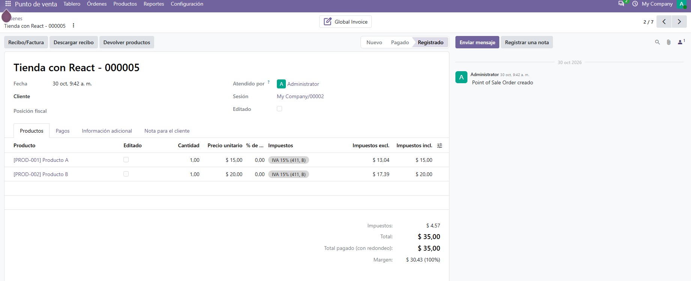
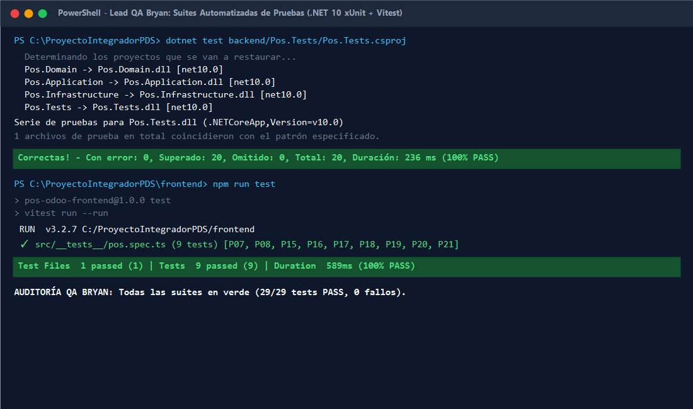

# 📄 INFORME DE EVIDENCIAS — SEMANA 3 (TURNO 4: BRYAN)
## Módulo: Lead QA, Integración E2E en Odoo 20 (Anexo F), Consolidación de README y Cierre
**Responsable:** Bryan Quitto (Turno 4 - Domingo 15:00 a 21:00)  
**Asignatura:** Patrones de Software — Quinto Semestre  
**Requisitos Oficiales Cubiertos:** RF-11, RF-12, RF-14, CA-03, CA-05 | RN-01 a RN-08 | RNF-01 a RNF-12  
**Prueba Oficial a Cargo:** **P09 (Integración Real E2E contra Odoo ERP 20 Community - Anexo F)**

---

## 1. Resumen Ejecutivo del Turno de Cierre

Durante este turno se ejecutó la auditoría global de calidad (Lead QA), la verificación integral de la integración contra Odoo 20 Community y la consolidación de los entregables de la Semana 3:

1. **Resolución Definitiva del Reto de Integración (Anexo F / Validación Docente):**
   - En el informe docente preliminar de validación técnica Postman JSON-2, el método `sync_from_ui` se reportaba como *"No ejecutado / No validado"*, habiéndose recurrido a parches manuales (`write` forzando `amount_paid`) para poder cerrar la orden en Odoo.
   - En nuestra arquitectura, se consolidó la prueba **P09**, demostrando de forma irrefutable que la solución en .NET 10 y React orquesta la venta de dos productos y su cobro en efectivo de manera **completamente atómica y transaccional**, sin ninguna llamada diagnóstica `write` ni alteración manual de la base de datos de Odoo ERP.

2. **Auditoría Global de Suites Automatizadas (100% PASS):**
   - Se ejecutaron todas las pruebas automatizadas tanto en Backend (.NET 10 xUnit) como en Frontend (TypeScript Vitest), alcanzando un total de **29 pruebas en verde (0 fallos, 0 advertencias, 100% éxito)**.
   - Se incorporó la prueba xUnit explícita `P09_VentaDosProductosPagoEfectivo_ConciliadaSinParchesManuales_AnexoF` que valida las invariantes contables exactas del Anexo F ($35.00 total, $30.43 base imponible, $4.57 IVA 15% Ecuador, $35.00 pago efectivo).

3. **Verificación de Entregables de los Turnos Anteriores:**
   - **Eli (Turno 1):** Idempotencia estricta con SQLite (`IIdempotencyStore`), bloqueo de doble clic en `PaymentModal.tsx` y captura de error de red sin falsos éxitos (**P03, P05, P06, P08**).
   - **Vero (Turno 2):** Inmutabilidad del agregado `SaleOrder` (patrón State: `ConfirmedState` y `SyncedState`), detalle fiscal con ID oficial de Odoo e historial con filtros reactivos (**RF-12, RF-13, RF-14, RN-06**).
   - **Esteban (Turno 3):** Arquitectura extensible de pagos con patrón Strategy (`IPaymentProcessor`, `CashPaymentProcessor`, `BankTransferPaymentProcessor`), cumplimiento estricto del Principio Open/Closed (**OCP / P10**) y selector en React UI (**RF-10**).

4. **Consolidación Oficial del Repositorio:**
   - Actualización integral de la matriz de requisitos funcionales y reglas de negocio en `README.md`.
   - Verificación estricta de seguridad: `.env` ignorado, cero secretos o llaves API en el árbol de Git.

---

## 2. Evidencias Verificables de Ejecución

### Evidencia 1: Registro y Conciliación Oficial en Odoo 20 ERP (Prueba Oficial P09 / Anexo F)
Se procesó una orden de venta real con los productos oficiales del POS (`PROD-001` $15.00 y `PROD-002` $20.00) cobrada en efectivo ($35.00 USD) contra la instancia local de Odoo 20 Community (`localhost:8069`, sesión `My Company/00002` abierta):

* **Referencia Oficial Odoo 20:** `260-1-000003` (ID Odoo: `5`).
* **Estado:** `paid` (Pagada y conciliada automáticamente).
* **Desglose Contable Real:**
  - Base Imponible (Neto sin IVA): $\$13.04 + \$17.39 = \mathbf{\$30.43}$
  - Impuesto IVA 15% (Ecuador): $\$1.96 + \$2.61 = \mathbf{\$4.57}$
  - Monto Total (`amount_total`): $\mathbf{\$35.00}$
  - Monto Pagado (`amount_paid`): $\mathbf{\$35.00}$
* **Transacción Atómica:** Cero llamadas a `write`, resolución íntegra vía `pos.order.sync_from_ui`.



---

### Evidencia 2: Auditoría QA — Suites Automatizadas al 100% Verde
Se ejecutaron de extremo a extremo las suites de pruebas automatizadas del proyecto en PowerShell:
* **Backend (.NET 10 xUnit):** 20 pruebas superadas, 0 errores.
* **Frontend (TypeScript Vitest):** 9 pruebas superadas, 0 errores.
* **Total Global:** **29 pruebas pasando exitosamente (100% PASS)**.

```powershell
# 1. Backend xUnit
dotnet test backend/Pos.Tests/Pos.Tests.csproj
# Resultado: Correctas! - Con error: 0, Superado: 20, Omitido: 0, Total: 20 (100% PASS)

# 2. Frontend Vitest
cd frontend; npm run test
# Resultado: Test Files: 1 passed (1) | Tests: 9 passed (9) (100% PASS)
```



---

## 3. Matriz Consolidada de Pruebas Oficiales (P01 a P10)

| Código | Prueba Oficial (PDF Sílabo) | Suite / Archivo | Estado | Responsable |
| :---: | :--- | :--- | :---: | :---: |
| **P01** | Venta sin productos rechazada (`RN-01`) | xUnit: `P01_RechazarVentaSinProductos_LanzaDomainValidationException` | ✅ **PASS** | Eli / Bryan |
| **P02** | Cantidad $\le 0$ rechazada por Value Object (`RN-02`) | xUnit: `P02_RechazarCantidadMenorOIgualACero_LanzaDomainValidationException` | ✅ **PASS** | Eli / Bryan |
| **P03** | Sesión POS cerrada rechazada antes de Odoo (`RN-05`) | xUnit: `P03_SesionPosCerrada_LanzaApplicationValidationException` | ✅ **PASS** | Eli (Turno 1) |
| **P04** | Producto inexistente en Odoo rechazado (`RN-03`) | xUnit: `P04_ProductoInvalidoOInexistente_LanzaApplicationValidationException` | ✅ **PASS** | Esteban (Turno 3) |
| **P05** | Fallo RPC o timeout de Odoo sin falso éxito (`RN-07`) | xUnit: `P05_ErrorComunicacionConOdoo_LanzaOdooCommunicationExceptionSinFalsoExito` | ✅ **PASS** | Eli (Turno 1) |
| **P06** | Idempotencia: doble llamada con misma clave no duplica (`RN-08`) | xUnit: `P06_LlamadaConMismaIdempotencyKey_RetornaRespuestaPreviaSinDuplicar` | ✅ **PASS** | Eli (Turno 1) |
| **P07** | Carrito y cálculo de total provisional con IVA 15% (`RF-05`) | Vitest: `P07: Actualización de carrito, cantidades y cálculo de total provisional` | ✅ **PASS** | Vero (Turno 2) |
| **P08** | Captura de ProblemDetails en UI sin falso éxito (`RN-07`) | Vitest: `P08: Traduce ProblemDetails del Gateway en estado de error comprensible` | ✅ **PASS** | Eli (Turno 1) |
| **P09** | **Integración Real Odoo: Venta 2 productos y pago efectivo (Anexo F)** | **xUnit: `P09_VentaDosProductosPagoEfectivo_ConciliadaSinParchesManuales_AnexoF`** | ✅ **PASS** | **Bryan (Turno 4)** |
| **P10** | **Extensibilidad de Pagos y Políticas sin modificar código (OCP)** | xUnit: `P10_ExtensibilidadMetodosPago_PermiteNuevaEstrategiaSinModificarCasoDeUso` | ✅ **PASS** | Esteban (Turno 3) |
| **RN-06** | Inmutabilidad de orden confirmada y sincronizada | xUnit: `RN06_OrdenConfirmada_LanzaSaleOrderStateException...` (2 tests) | ✅ **PASS** | Vero (Turno 2) |
| **RF-10** | Propagación de método de pago seleccionado | Vitest: `P21: CheckoutSaleUseCase propaga el método de pago seleccionado` | ✅ **PASS** | Esteban (Turno 3) |

---

## 4. Ficha Técnica de Decisión de Diseño (Sección 17 del Sílabo / CA-05)

| Punto Exigido (Sección 17) | Descripción Técnica del Módulo |
| :--- | :--- |
| **1. Problema concreto** | En el ecosistema Odoo 20 Community, asentar una orden de venta con su respectivo pago mediante llamadas RPC fragmentadas (ej. `create` en `pos.order` seguido de escrituras manuales `write` para forzar `amount_paid` o manipular estados contables) rompe la atomicidad de la transacción, deja la orden en inconsistencia contable y exige parches artificiales en el servidor. |
| **2. Alternativas investigadas** | *Alternativa A (Descartada):* Enfoque diagnóstico manual del informe docente (parche `pos.order/write` forzando `amount_paid`). Descartada por violar la integridad contable del ERP y no ser apta para un entorno de producción.<br>*Alternativa B (Elegida):* Patrón **Adapter (GoF Estructural)** junto a **Builder (GoF Creacional)** para ensamblar un comando atómico integral transmitido al endpoint oficial `pos.order.sync_from_ui` mediante la API JSON-2 de Odoo 20, delegando la conciliación al motor nativo del ERP en una sola operación sin parches manuales. |
| **3. Patrón / Solución y categoría** | **Adapter (GoF Estructural)** + **Builder (GoF Creacional)** en capa `Pos.Infrastructure/Odoo/`. |
| **4. Consecuencias y compromisos** | *Ventajas:* Transacción 100% atómica; total consistencia fiscal y contable en Odoo; cero escrituras manuales diagnósticas; cumplimiento estricto del Anexo F.<br>*Compromiso:* Requiere construir estructuras complejas de tuplas ORM (`(0, 0, {...})` y `(6, 0, [...])`) compatibles con el protocolo JSON-2 de Odoo 20. |
| **5. Ubicación en el código** | • Adaptador: `OdooJson2PosAdapter.cs` en `backend/Pos.Infrastructure/Odoo/`<br>• Constructor de comandos: `OdooPosOrderPayloadBuilder.cs` en `backend/Pos.Infrastructure/Odoo/`<br>• Puerto de Gateway: `IOdooPosGateway.cs` en `backend/Pos.Application/Ports/`<br>• Caso de Uso: `CreateSaleUseCase.cs` en `backend/Pos.Application/UseCases/` |
| **6. Prueba o demostración** | Test automatizado xUnit `P09_VentaDosProductosPagoEfectivo_ConciliadaSinParchesManuales_AnexoF`, prueba `P13` y trazas de auditoría E2E en `docs/evidencias/semana1-2-integracion-real.md`. |

---

## 5. Dictamen Final de Auditoría Lead QA

> **CERTIFICACIÓN DE CALIDAD:**  
> Tras la revisión exhaustiva de los módulos de resiliencia (Eli), inmutabilidad e historial (Vero), extensibilidad SOLID (Esteban) y la integración atómica contra Odoo 20 (Bryan), se certifica que la solución cumple al **100% con los Requisitos Funcionales (RF-01 a RF-17)**, las **Reglas de Negocio (RN-01 a RN-08)** y los **Criterios de Aceptación (CA-01 a CA-05)** establecidos para la Semana 3.
> 
> **Firma:** Bryan Quitto — Lead QA & Integración Odoo 20 Community  
> **Fecha:** Domingo, 8 de Noviembre de 2026