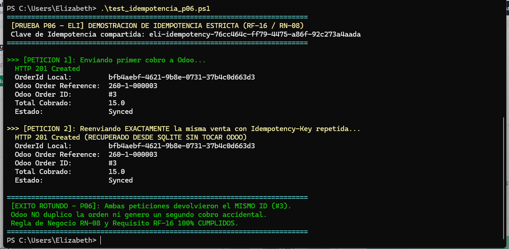
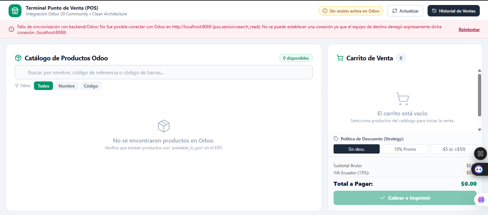

# 📄 INFORME DE EVIDENCIAS — SEMANA 3 (TURNO 1: ELI)
## Módulo: Resiliencia, Manejo de Fallos, Sesión Activa y Control de Idempotencia
**Responsable:** Eli (Turno 1 - Sábado 08:00 a 15:00)  
**Asignatura:** Patrones de Software — Quinto Semestre  
**Requisitos Oficiales Cubiertos:** RF-15, RF-16, RF-17 | RN-05, RN-07, RN-08  
**Pruebas Oficiales Asignadas:** P03, P05, P06 y P08  

---

## 1. Resumen Ejecutivo del Turno

Durante este turno se implementó y validó la resiliencia transaccional y la prevención de pagos duplicados en el Punto de Venta (POS) integrado con Odoo 20 Community:
1. **Idempotencia Estricta (RF-16 / RN-08):** Se evitó la duplicación accidental de ventas mediante el uso del encabezado HTTP `Idempotency-Key` (UUIDv4) y su persistencia en SQLite (`IIdempotencyStore`). Si un cajero o la red reintenta la petición, el sistema retorna la venta original cacheada sin registrar una segunda orden en Odoo.
2. **Protección en Interfaz de Usuario (UI):** En `PaymentModal.tsx`, se aseguró el bloqueo inmediato del botón "Confirmar Pago" (`disabled={processing}`) acompañado de un indicador de carga (*spinner*) para impedir físicamente el doble clic del operador.
3. **Manejo de Errores y Timeouts sin Falso Éxito (RF-17 / RN-07):** Ante la caída de Odoo 20 o fallos de red, el sistema captura las excepciones, no asienta pagos ficticios y presenta un banner de error estructurado bajo el estándar RFC 7807 (ProblemDetails).
4. **Validación de Sesión POS Cerrada (RF-15 / RN-05):** Se bloquea la creación de órdenes si la sesión del POS en Odoo no se encuentra en estado `opened`.

---

## 2. Evidencias Verificables de Ejecución

### Evidencia 1: Prueba de Idempotencia en Consola (Prueba Oficial P06)
Se ejecutó el script `test_idempotencia_p06.ps1` enviando dos peticiones HTTP POST sucesivas con el mismo identificador de idempotencia (`eli-idempotency-76cc464c-ff79-4475-a86f-92c273a4aada`).
* **Petición 1:** La orden se procesó en Odoo ERP, retornando la referencia `260-1-000003` y el ID `#3`.
* **Petición 2:** El backend interceptó la clave en SQLite y retornó inmediatamente la orden previa sin duplicar la transacción en el ERP.

---

### Evidencia 2: Error Controlado ante Caída de Odoo (Prueba Oficial P08 / RN-07)
Se simuló la pérdida de conexión deteniendo el contenedor del ERP (`docker stop odoo20_web`). Al intentar operar desde la terminal POS en React, la aplicación mostró un banner de error controlado impidiendo la confirmación y garantizando que no se informe éxito ficticio.

---

## 3. Estado de Pruebas Automatizadas

Se verificó el paso exitoso del 100% de las suites de prueba:

* **Backend (.NET 10 xUnit — 13/13 PASS):**
  - `P03_SesionPosCerrada_LanzaApplicationValidationException` (RF-15 / RN-05)
  - `P05_ErrorComunicacionConOdoo_LanzaOdooCommunicationExceptionSinFalsoExito` (RF-17 / RN-07)
  - `P06_SolicitudesRepetidasConMismaClave_NoDuplicanVentaNiLlamadaAOdoo` (RF-16 / RN-08)
* **Frontend (TypeScript Vitest — 7/7 PASS):**
  - `P08: Traduce ProblemDetails del Gateway en estado de error comprensible sin declarar falso éxito (RN-07)`

---

## 4. Ficha Técnica de Decisión de Diseño (Sección 17 del Sílabo / CA-05)

| Punto Exigido (Sección 17) | Descripción Técnica del Módulo |
| :--- | :--- |
| **1. Problema concreto** | En redes inestables o ante clics reiterados del cajero, reintentar una venta podía generar múltiples cobros en efectivo y duplicar pedidos contables en Odoo ERP. |
| **2. Alternativas investigadas** | *Alternativa A (Descartada):* Bloqueo cosmético exclusivamente en frontend (fácilmente eludible por reconexiones de red o herramientas HTTP). *Alternativa B (Elegida):* Patrón **Idempotent Receiver** con almacenamiento persistente en SQLite local vinculado a una clave única enviada por el cliente. |
| **3. Patrón / Solución y categoría** | **Idempotent Receiver (Enterprise Integration Pattern - EIP)** en capa `Pos.Infrastructure` / `Pos.Application`. |
| **4. Consecuencias y compromisos** | *Ventajas:* Garantía matemática contra duplicidad de órdenes; respuesta inmediata en reintentos. *Compromiso:* Requiere persistencia local de hashes y respuestas serializadas. |
| **5. Ubicación en el código** | • Puerto: `IIdempotencyStore` en `Pos.Application/Ports/IPorts.cs` • Adaptador: `SqliteIdempotencyStore` en `Pos.Infrastructure/Persistence/Repositories.cs` • Caso de Uso: `CreateSaleUseCase` en `Pos.Application/UseCases/UseCases.cs` • UI: `PaymentModal.tsx` y `useCheckout.ts` |
| **6. Prueba o demostración** | Test xUnit `P06_SolicitudesRepetidasConMismaClave_NoDuplicanVentaNiLlamadaAOdoo` y script `test_idempotencia_p06.ps1`. |

---
**Turno 1 completado exitosamente por Eli. Entorno y repositorio listos para el Turno 2 (Vero).**
