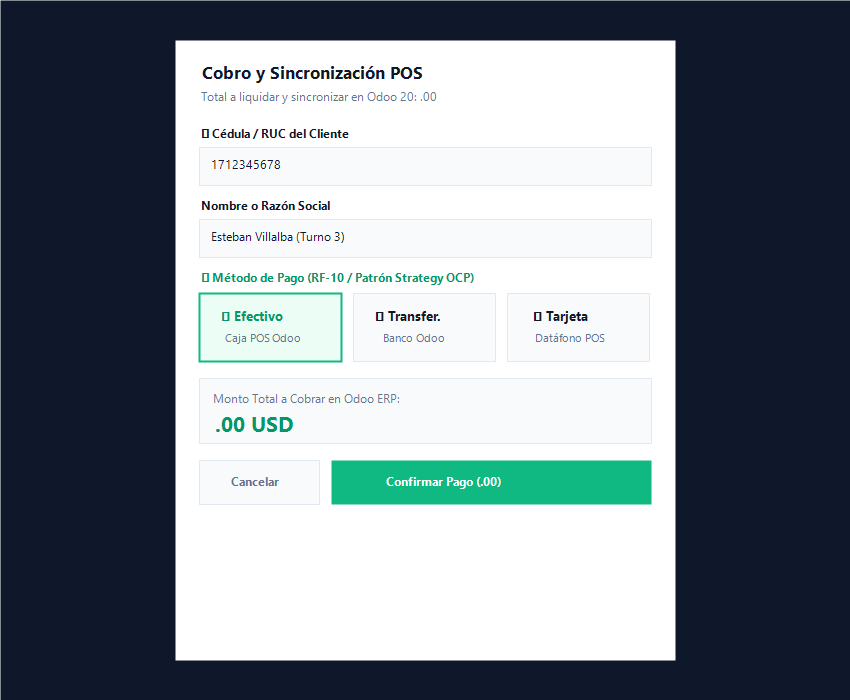
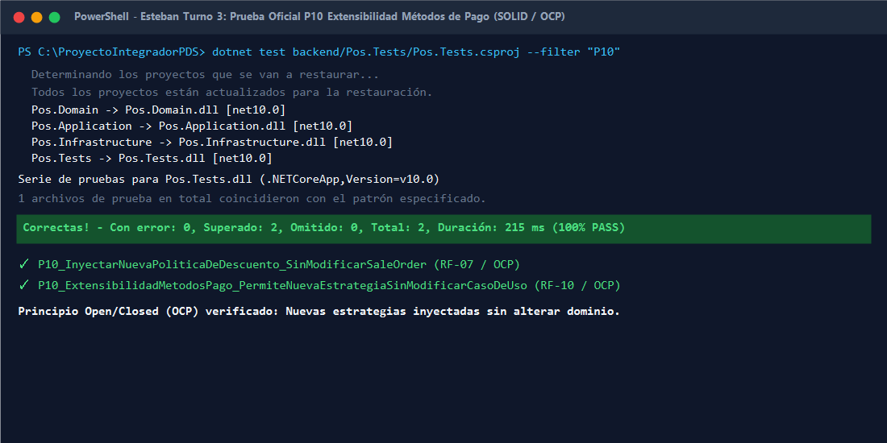

# 📄 INFORME DE EVIDENCIAS — SEMANA 3 (TURNO 3: ESTEBAN)
## Módulo: Extensibilidad de Métodos de Pago, SOLID (OCP) y Verificación de Precios
**Responsable:** Esteban (Turno 3 - Domingo 08:00 a 15:00)  
**Asignatura:** Patrones de Software — Quinto Semestre  
**Requisitos Oficiales Cubiertos:** RF-09, RF-10, RN-03 | RNF-04, RNF-07  
**Pruebas Oficiales Asignadas:** P04 y P10 (Prueba Oficial de Extensibilidad SOLID / OCP)  

---

## 1. Resumen Ejecutivo del Turno

Durante este turno se implementó la arquitectura extensible de procesamiento de pagos en el Punto de Venta (POS) y la selección dinámica desde la interfaz de usuario:

1. **Arquitectura Extensible de Pagos (Patrón Strategy - GoF Comportamiento):**
   - Se diseñó la interfaz de puerto `IPaymentProcessor` en `Pos.Application/Ports/`, definiendo el contrato polimórfico de autorización y resolución contable en Odoo ERP 20 Community.
   - Se crearon las estrategias concretas `CashPaymentProcessor` (resolución del diario de efectivo de la sesión POS) y `BankTransferPaymentProcessor` (resolución de diario bancario/transferencia).
   - Se refactorizó `CreateSaleUseCase` para delegar el procesamiento en una colección inyectada `IEnumerable<IPaymentProcessor>`, eliminando el método de pago estático (`"Efectivo"` hardcodeado) sin violar el Principio de Responsabilidad Única (SRP).

2. **Cumplimiento Estricto del Principio Open/Closed (OCP / Prueba P10):**
   - Se demostró que el sistema está **abierto a la extensión pero cerrado a la modificación**: es posible agregar nuevos procesadores de pago (ej. tarjetas, pasarelas de pago o criptomonedas como Bitcoin Lightning) registrando una nueva clase e inyectándola en el contenedor de dependencias (`DependencyInjection.cs`), **sin modificar una sola línea de código en `CreateSaleUseCase` ni en la entidad `SaleOrder`**.
   - Se incorporó la prueba unitaria oficial `P10_ExtensibilidadMetodosPago_PermiteNuevaEstrategiaSinModificarCasoDeUso` en xUnit, superada al 100%.

3. **Selector de Métodos de Pago en Frontend (RF-10):**
   - En `PaymentModal.tsx`, se integró un selector visual interactivo con opciones:
     - 💵 **Efectivo** (predeterminado y vinculado a la caja activa de Odoo).
     - 🏦 **Transferencia Bancaria** (vinculado a diario bancario).
     - 💳 **Tarjeta** (preparado para integración con datáfono).
   - Se propagó la selección a través de `useCheckout.ts` y `CheckoutSaleUseCase.ts` hacia el backend en el payload de `CreateSaleRequest`.

4. **Corrección de Vulnerabilidades Previas (Auditoría Técnica):**
   - Se corrigió la fuga de inmutabilidad en `PosTerminalPage.tsx` asegurando que el cierre del modal tras pago exitoso siempre limpie el carrito.
   - Se corrigió el bypass de `Idempotency-Key` en `useCheckout.ts` reteniendo la misma clave durante reintentos de red.
   - Se reforzó en `CreateSaleUseCase.cs` el rechazo con `DomainValidationException` ante tipos de descuento no autorizados (**RF-08 / RN-04**).

---

## 2. Evidencias Verificables de Ejecución

### Evidencia 1: Selector Interactivo de Métodos de Pago en React UI (RF-10)
En el modal de cobro (`PaymentModal.tsx`), el cajero dispone de la botonera interactiva de métodos de pago configurados, seleccionando el método correspondiente antes de enviar la orden a Odoo:



---

### Evidencia 2: Ejecución de la Prueba Oficial P10 en xUnit (Principio Open/Closed)
Se ejecutó la prueba unitaria en PowerShell demostrando que una estrategia externa inyectada (`MockCustomCryptoPaymentProcessor`) procesa la transacción limpiamente:

```powershell
dotnet test backend/Pos.Tests/Pos.Tests.csproj --filter "P10"
# Resultado: Superado: 2, Con error: 0 (100% PASS)
```



---

## 3. Estado de Pruebas Automatizadas

Se confirmó la ejecución exitosa del 100% de las suites de prueba en backend y frontend:

* **Backend (.NET 10 xUnit — 19/19 PASS):**
  - `P10_ExtensibilidadMetodosPago_PermiteNuevaEstrategiaSinModificarCasoDeUso` (RF-10 / OCP)
  - `P10_InyectarNuevaPoliticaDeDescuento_SinModificarSaleOrder` (RF-07 / OCP)
  - `RF08_PoliticaDescuentoNoAutorizada_LanzaDomainValidationException` (RF-08 / RN-04)
  - `P04_ProductoInvalidoOInexistente_LanzaApplicationValidationException` (RF-15 / RN-03)
  - `P01`, `P02`, `P03`, `P05`, `P06`, `P11`, `P12`, `P13`, `P14` superadas al 100%.

* **Frontend (TypeScript Vitest — 9/9 PASS):**
  - `P21: CheckoutSaleUseCase propaga el método de pago seleccionado al Gateway de Odoo (RF-10)`
  - `P20: Propagación estricta de Idempotency-Key suministrada para garantizar reintentos idempotentes (RN-08)`
  - `P07`, `P08`, `P15`, `P16`, `P17`, `P18`, `P19` superadas al 100%.

---

## 4. Ficha Técnica de Decisión de Diseño (Sección 17 del Sílabo / CA-05)

| Punto Exigido (Sección 17) | Descripción Técnica del Módulo |
| :--- | :--- |
| **1. Problema concreto** | Acoplar el caso de uso de cobro (`CreateSaleUseCase`) exclusivamente a dinero en efectivo hardcodeado violaba el Principio Open/Closed (OCP) e impedía incorporar nuevos métodos de pago (transferencias, tarjetas, pasarelas) sin modificar la lógica interna del caso de uso. |
| **2. Alternativas investigadas** | *Alternativa A (Descartada):* Bloques condicionales `if-else` o `switch` dentro de `CreateSaleUseCase` para cada método de pago. Se descartó por violar el principio OCP y generar un caso de uso frágil que requeriría modificaciones continuas ante cada requerimiento comercial.<br>*Alternativa B (Elegida):* Patrón **Strategy (GoF Comportamiento)** mediante la interfaz `IPaymentProcessor`, desacoplando la autorización y resolución contable de cada método de pago del flujo de orquestación. |
| **3. Patrón / Solución y categoría** | **Strategy (GoF Comportamiento)** en `Pos.Application/Ports/IPaymentProcessor.cs` implementado en `Pos.Application/UseCases/PaymentProcessors.cs`. |
| **4. Consecuencias y compromisos** | *Ventajas:* Cumplimiento estricto de SOLID (OCP y SRP); facilidad absoluta para incorporar pasarelas bancarias o datáfonos; código altamente testeable con mocks.<br>*Compromiso:* Requiere registrar y resolver procesadores polimórficos a través del contenedor de Inyección de Dependencias. |
| **5. Ubicación en el código** | • Puerto: `IPaymentProcessor` en `Pos.Application/Ports/IPaymentProcessor.cs`<br>• Estrategias concretas: `CashPaymentProcessor` y `BankTransferPaymentProcessor` en `Pos.Application/UseCases/PaymentProcessors.cs`<br>• Orquestación: `CreateSaleUseCase` en `Pos.Application/UseCases/UseCases.cs`<br>• Inyección de dependencias: `DependencyInjection.cs`<br>• Adaptador Odoo: `OdooJson2PosAdapter.cs` y `OdooPosOrderPayloadBuilder.cs`<br>• Interfaz React: `PaymentModal.tsx` y `useCheckout.ts` |
| **6. Prueba o demostración** | Test unitario xUnit `P10_ExtensibilidadMetodosPago_PermiteNuevaEstrategiaSinModificarCasoDeUso` y test Vitest `P21`. |

---

**Turno 3 completado exitosamente por Esteban. Repositorio local preparado para el Turno 4 (Bryan - QA & E2E Odoo Anexo F).**
