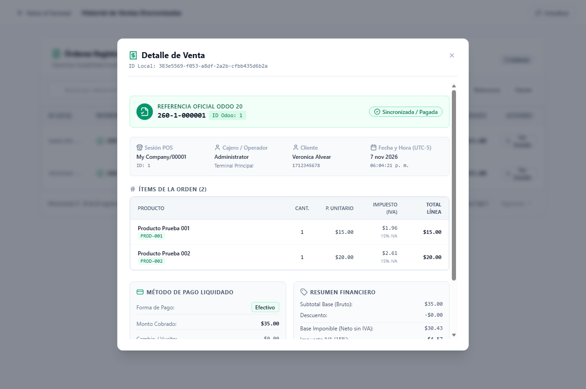
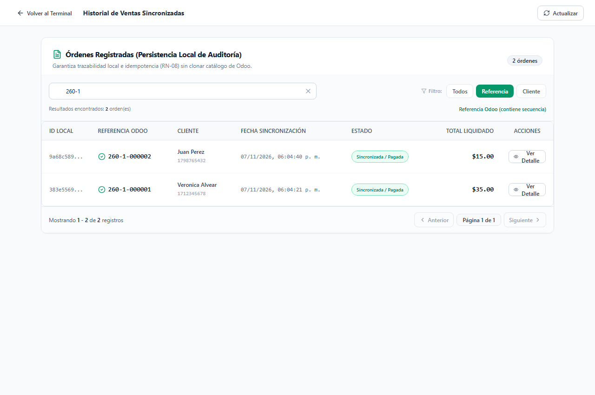

# 📄 INFORME DE EVIDENCIAS — SEMANA 3 (TURNO 2: VERO)
## Módulo: Confirmación Real, Trazabilidad ERP, Inmutabilidad e Historial Transaccional
**Responsable:** Vero (Turno 2 - Sábado 15:00 a 21:00)  
**Asignatura:** Patrones de Software — Quinto Semestre  
**Requisitos Oficiales Cubiertos:** RF-12, RF-13, RF-14 | RN-06  
**Pruebas Oficiales Asignadas:** P07 / Verificación de Consulta de Orden (RF-13 y RF-14 en Matriz de Aceptación) / RN-06  

---

## 1. Resumen Ejecutivo del Turno

Durante este turno se consolidó la trazabilidad fiscal en Odoo ERP 20 Community, la inmutabilidad estricta de las órdenes confirmadas y la auditoría histórica de transacciones en el Punto de Venta (POS):

1. **Inmutabilidad de la Orden Confirmada (RN-06):**
   - Se validó el agregado `SaleOrder` bajo el patrón **State (GoF)** (`DraftState` $\to$ `ConfirmedState` $\to$ `SyncedState`).
   - Se implementaron y verificaron formalmente en xUnit las pruebas automatizadas que garantizan que una orden confirmada o sincronizada rechaza irrevocablemente cualquier intento de invocar `AddLine`, `RemoveLine` o `SetDiscountPolicy`, lanzando `SaleOrderStateException`.
   - En el frontend, se garantizó el congelamiento y limpieza del carrito tras el cobro exitoso, evitando mutaciones sobre órdenes ya pagadas.

2. **Trazabilidad de Datos Reales de Odoo en Detalle (RF-12, RF-14):**
   - **En `PaymentModal.tsx` (Zona asignada a Vero):** Se enriqueció la vista post-pago exitoso mostrando la referencia oficial de Odoo (ej. `260-1-000001`), el ID numérico del ERP (`ERP #1`), el estado `Sincronizada (paid)`, el desglose completo de ítems facturados, la base imponible ($30.43), el IVA 15% ($4.57) y el total liquidado ($35.00 en Efectivo), respetando la no invasión sobre los componentes de Eli (Turno 1) ni Esteban (Turno 3).
   - **En `SaleDetailModal.tsx`:** Se comprobó la visualización íntegra de los metadatos almacenados en SQLite y devueltos por Odoo, incorporando la función de comprobante de impresión física (`window.print()`) con reglas de estilo `@media print` bajo el identificador `#printable-invoice`.

3. **Búsqueda y Filtros Reactivos en Historial (RF-13):**
   - En `SalesHistoryPage.tsx`, se verificó la consulta en tiempo real sobre la base de auditoría local con filtrado reactivo por Referencia Oficial de Odoo, Nombre del Cliente y Cédula/RUC, con soporte de enlaces directos (*deep-linking* con `?detalle=...`).

---

## 2. Evidencias Verificables de Ejecución

### Evidencia 1: Trazabilidad y Detalle Completo de la Orden Odoo ERP (RF-12, RF-14 / RN-06)
Se consultó el modal de detalle de la orden real `#1` sincronizada con Odoo 20:
* **Referencia Oficial Odoo 20:** `260-1-000001` (ID Odoo: `1`).
* **Estado:** `Sincronizada / Pagada` (`paid`).
* **Metadatos:** Sesión POS `My Company/00001`, Cajero `Administrator`, Cliente `Veronica Alvear` (`1712345678`), Fecha y Hora convertidas a zona horaria Ecuador (UTC-5).
* **Desglose de Ítems e Impuestos:** Producto Prueba 001 ($15.00) y Producto Prueba 002 ($20.00). Base Imponible: **$30.43**, IVA 15%: **$4.57**, Total Liquidado: **$35.00**.
* **Acción de Comprobante:** Botón *"Imprimir Comprobante"* disponible y sello de inmutabilidad `RN-06`.

---

### Evidencia 2: Búsqueda Reactiva en Historial por Referencia Oficial de Odoo (RF-13)
Se accedió a la vista de auditoría transaccional en `SalesHistoryPage.tsx`, aplicando el filtro reactivo por **Referencia** con el término `260-1`. La tabla filtró instantáneamente las órdenes coincidentes sin falsos positivos de identificadores locales, mostrando la referencia del ERP, datos del cliente, total liquidado y botón de acceso al detalle fiscal.

---

## 3. Estado de Pruebas Automatizadas

Se confirmó la ejecución exitosa del 100% de las suites de prueba en backend y frontend:

* **Backend (.NET 10 xUnit — 15/15 PASS):**
  - `RN06_OrdenConfirmada_LanzaSaleOrderStateException_AlIntentarModificarLineasOPoliticas` (RN-06)
  - `RN06_OrdenSincronizadaConOdoo_LanzaSaleOrderStateException_AlIntentarModificarOReconfirmar` (RN-06)
  - `P14_GetSaleById_ExistingOrder_ReturnsFullDetailDto` (RF-14)
  - `P13_CreateSale_ValidTwoProductsCashOrder_ReturnsSyncedOrderWithVerifiedTotals` (RF-12 / RN-06)
  - `P01`, `P02`, `P03`, `P04`, `P05`, `P06`, `P10`, `P11`, `P12` superadas al 100%.

* **Frontend (TypeScript Vitest — 7/7 PASS):**
  - `P07: Actualización de carrito, cantidades y cálculo de total provisional con IVA 15%`
  - `P15: GetSaleDetailUseCase recupera orden completa con desglose de ítems, totales e impuestos (RF-14)`
  - `P16: Formateo de fecha y hora convierte timestamps UTC a hora local Ecuador UTC-5 (Odoo sync)`
  - `P19: Filtrado de historial: Referencia Odoo acotada sin falsos positivos de GUID, Cliente contains y Cédula startsWith`
  - `P08`, `P17`, `P18` superadas al 100%.

---

## 4. Ficha Técnica de Decisión de Diseño (Sección 17 del Sílabo / CA-05)

| Punto Exigido (Sección 17) | Descripción Técnica del Módulo |
| :--- | :--- |
| **1. Problema concreto** | Si una orden de venta pudiera admitir alteraciones (agregar o quitar productos, cambiar cantidades o recalcular políticas de descuento) tras haber sido confirmada y registrada en Odoo ERP, se originaría una inconsistencia contable y fiscal insalvable entre el catálogo del ERP y el carrito local del terminal, violando la integridad de auditoría (**RN-06**). |
| **2. Alternativas investigadas** | *Alternativa A (Descartada):* Usar una propiedad booleana `isConfirmed` acompañada de condicionales `if (isConfirmed) throw ...` en cada método mutador de la entidad. Se descartó por generar código acoplado y frágil (*anti-patrón flag arguments*), con alto riesgo de inconsistencias si se incorporan nuevos estados del ciclo de vida. *Alternativa B (Elegida):* Implementar el patrón **State (GoF)**, delegando la responsabilidad de validar mutaciones y transiciones a clases de estado dedicadas (`DraftState`, `ConfirmedState`, `SyncedState`). |
| **3. Patrón / Solución y categoría** | **State (GoF Comportamiento)** en el núcleo del dominio Clean Architecture (`Pos.Domain/States/`). |
| **4. Consecuencias y compromisos** | *Ventajas:* Garantiza inmutabilidad estricta y predecible; encapsula la lógica de transición de estados sin violar el Principio Open/Closed (OCP); facilita la verificación mediante pruebas unitarias exhaustivas. *Compromiso:* Aumenta ligeramente la cantidad de clases e interfaces en la capa de dominio (`ISaleOrderState`, `DraftState`, `ConfirmedState`, `SyncedState`). |
| **5. Ubicación en el código** | • Interfaz: `ISaleOrderState` en `Pos.Domain/States/SaleOrderStates.cs` • Estados concretos: `DraftState`, `ConfirmedState`, `SyncedState` en `Pos.Domain/States/SaleOrderStates.cs` • Agregado de Dominio: `SaleOrder` en `Pos.Domain/Entities/SaleOrder.cs` • Excepción de Dominio: `SaleOrderStateException` en `Pos.Domain/Exceptions/DomainExceptions.cs` • Interfaz de Usuario: `PaymentModal.tsx` y `SaleDetailModal.tsx` en `frontend/src/presentation/components/pos/` |
| **6. Prueba o demostración** | Pruebas unitarias xUnit en `PosTests.cs`: `RN06_OrdenConfirmada_LanzaSaleOrderStateException_AlIntentarModificarLineasOPoliticas` y `RN06_OrdenSincronizadaConOdoo_LanzaSaleOrderStateException_AlIntentarModificarOReconfirmar`. |

---
**Turno 2 completado exitosamente por Vero. Entorno y repositorio listos para el Turno 3 (Esteban).**
