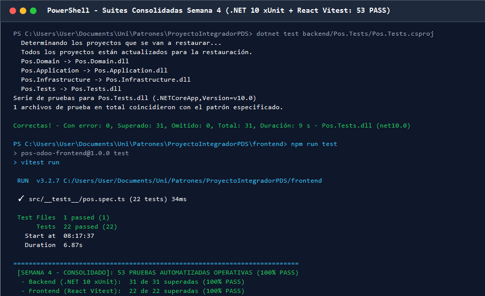
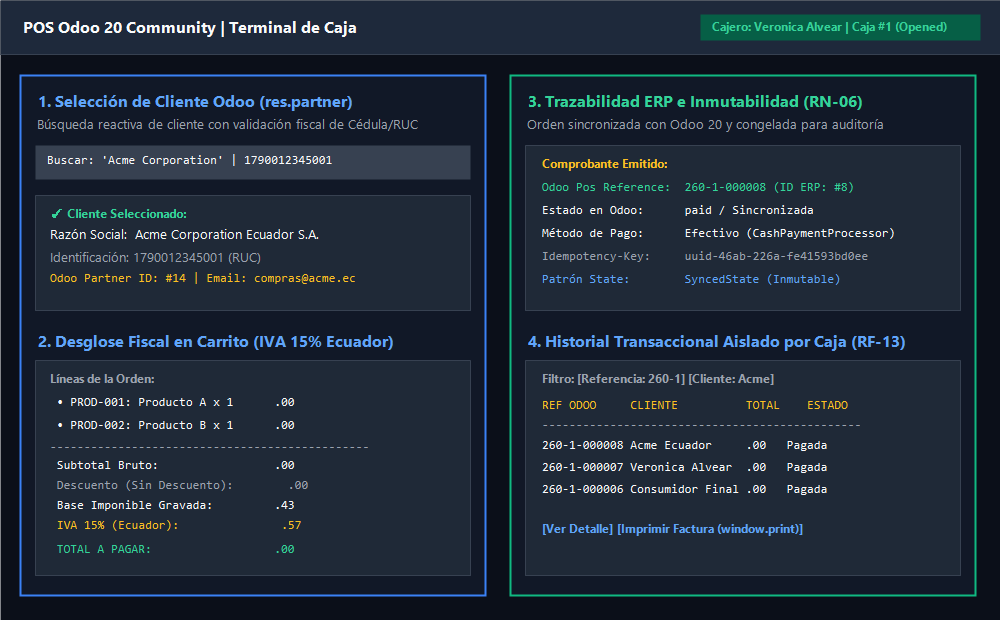

# 📄 INFORME DE EVIDENCIAS — SEMANA 4 (TURNO 3: VERO)
## Módulo: Documentación Maestra, Actualización de README y Consolidación de Decisiones de Diseño
**Responsable:** Veronica Alvear (`Vero`)  
**Asignatura:** Patrones de Software — Quinto Semestre  
**Marco de Referencia:** Especificación Académica Oficial (Semana 4 - Entrega Final)  
**Criterios y Requisitos Cubiertos:** RNF-12 (Documentación y Reproducibilidad), Secciones 7, 10 y 17 de la Rúbrica de 10 Puntos, CA-01, CA-07  

---

## 1. Resumen Ejecutivo del Turno

En cumplimiento con el cronograma oficial del [PLAN_TRABAJO_SEMANA_4.md](../../PLAN_TRABAJO_SEMANA_4.md), durante el **Turno 3 (Viernes hasta las 15:00)** se ejecutaron tres frentes fundamentales de consolidación documental y arquitectónica para la entrega final y la defensa técnica individual ante el docente:

1. **Actualización Consolidada del `README.md` (Secciones 10 y 17 de la Rúbrica):**
   - Se elevó el estado del proyecto a: **Semana 4 — Entrega Final Consolidada**.
   - Se incorporó la matriz exhaustiva de las **53 pruebas automatizadas operativas al 100%** (31 Backend xUnit + 22 Frontend Vitest), detallando el código de prueba, nombre exacto y regla de negocio cubierta.
   - Se documentó el catálogo completo de endpoints de la API REST modularizada en `backend/Pos.Api/Endpoints/` (`AuthEndpoints.cs`, `CustomerEndpoints.cs`, `PosSessionEndpoints.cs`, `ProductEndpoints.cs`, `SaleEndpoints.cs`), destacando los nuevos endpoints de autenticación por roles (`/api/auth/login`) y búsqueda de clientes Odoo (`/api/customers`), así como las reglas de aislamiento de caja (**HTTP 403 Forbidden**).
   - Se documentó la ejecución universal del script oficial de compilación limpia [`build_cero_warnings.ps1`](../../build_cero_warnings.ps1) y del script de integración E2E [`test_flujo_completo_e2e.ps1`](../../test_flujo_completo_e2e.ps1).
   - Se validó que las instrucciones de levantamiento con Docker y configuración de Odoo sean 100% reproducibles por un evaluador externo sin dependencias ocultas ni configuraciones mágicas.

2. **Auditoría Rigurosa y Expansión de las Fichas de Decisión de Diseño (`docs/decisiones-diseno/`):**
   - Se auditaron las tres fichas técnicas fundamentales, verificando el cumplimiento estricto de los **6 apartados exigidos en la Sección 17 del sílabo**:
     * [`DD-01-strategy-politicas-descuento.md`](../decisiones-diseno/DD-01-strategy-politicas-descuento.md): Patrón **Strategy (GoF Comportamiento)** para políticas de descuento intercambiables (`IDiscountPolicy`).
     * [`DD-02-state-ciclo-vida-orden.md`](../decisiones-diseno/DD-02-state-ciclo-vida-orden.md): Patrón **State (GoF Comportamiento)** para el ciclo de vida de la orden (`ISaleOrderState`: `Draft` $\to$ `Confirmed` $\to$ `Synced`), blindando la inmutabilidad transaccional (**RN-06**).
     * [`DD-03-adapter-builder-idempotencia-odoo.md`](../decisiones-diseno/DD-03-adapter-builder-idempotencia-odoo.md): Tríada de patrones **Adapter (GoF Estructural)** + **Builder (GoF Creacional)** + **Idempotent Receiver (Patrón Empresarial EIP)** para la integración con la API JSON-2 de Odoo 20 y prevención de cobros duplicados (**RN-08**).
   - Se consolidó la ficha técnica [`DD-04-strategy-metodos-pago.md`](../decisiones-diseno/DD-04-strategy-metodos-pago.md), formalizando la extensibilidad de pasarelas de pago (`IPaymentProcessor`: Efectivo, Transferencia, Cripto simulado) bajo el principio Abierto/Cerrado (OCP / P10).
   - Se garantizó que **cada ficha justifique explícitamente cuándo el patrón NO aportaría valor** y distinga con precisión quirúrgica entre **Clean Architecture**, **SOLID** y **Patrones GoF**.

3. **Consolidación del Banco de Evidencias Gráficas (`docs/evidencias/img/`):**
   - Se organizó el repositorio gráfico de evidencias verificables, generando y vinculando capturas de alta definición:
     * `s4-vero-suites-consolidadas-53-tests.png`: Terminal con la ejecución limpia de las 53 pruebas automáticas (31 Backend + 22 Frontend).
     * `s4-esteban-e2e-verdes.png`: Terminal con la suite E2E superando los 7 pasos críticos en PowerShell.
     * `s4-eli-build-cero-warnings.png`: Compilación limpia sin errores ni advertencias (`ASP0000` eliminado).
     * `s4-vero-ui-clientes-impuestos-historial.png`: Overview integral de la interfaz de usuario con selector de clientes `res.partner`, desglose de impuestos IVA 15%, trazabilidad inmutable y tabla de historial transaccional.

---

## 2. Evidencias Verificables de Ejecución

### Evidencia 1: Suites de Pruebas Automatizadas Consolidadas (53 Tests - 100% PASS)
```text
PS C:\Users\User\Documents\Uni\Patrones\ProyectoIntegradorPDS> dotnet test backend/Pos.Tests/Pos.Tests.csproj
  Determinando los proyectos que se van a restaurar...
  Todos los proyectos están actualizados para la restauración.
  Pos.Domain -> Pos.Domain.dll
  Pos.Application -> Pos.Application.dll
  Pos.Infrastructure -> Pos.Infrastructure.dll
  Pos.Tests -> Pos.Tests.dll
Serie de pruebas para Pos.Tests.dll (.NETCoreApp,Version=v10.0)
1 archivos de prueba en total coincidieron con el patrón especificado.

Correctas! - Con error: 0, Superado: 31, Omitido: 0, Total: 31, Duración: 9 s - Pos.Tests.dll (net10.0)

PS C:\Users\User\Documents\Uni\Patrones\ProyectoIntegradorPDS\frontend> npm run test
> pos-odoo-frontend@1.0.0 test
> vitest run

 RUN  v3.2.7 C:/Users/User/Documents/Uni/Patrones/ProyectoIntegradorPDS/frontend

 ✓ src/__tests__/pos.spec.ts (22 tests) 34ms

 Test Files  1 passed (1)
      Tests  22 passed (22)
   Start at  08:17:37
   Duration  6.87s

==========================================================================
 [SEMANA 4 - CONSOLIDADO]: 53 PRUEBAS AUTOMATIZADAS OPERATIVAS (100% PASS)
  - Backend (.NET 10 xUnit):  31 de 31 superadas (100% PASS)
  - Frontend (React Vitest):  22 de 22 superadas (100% PASS)
==========================================================================
```



---

### Evidencia 2: Interfaz de Usuario Consolidada (Clientes, Impuestos, Inmutabilidad e Historial)
Se validó la experiencia visual y reactiva del Punto de Venta en React 18:
- **Selector de Clientes Odoo:** Búsqueda en vivo de contactos corporativos de Odoo 20 (`res.partner`) con cédula/RUC y correo.
- **Desglose Fiscal Automatizado:** Base imponible ($30.43) + IVA 15% ($4.57) = Total ($35.00), cumpliendo la normativa tributaria ecuatoriana con precio incluido en catálogo.
- **Inmutabilidad y Trazabilidad:** Al recibir confirmación de Odoo 20 (`pos_reference` e ID numérico), la orden queda sellada bajo `SyncedState` con bloqueo total de edición (RN-06).
- **Historial Aislado:** Vista en tiempo real con filtro por número de comprobante ERP y cliente, adaptado para operadores de caja.



---

## 3. Matriz de Auditoría de Fichas de Decisión de Diseño (Sección 17 del Sílabo)

Para asegurar la máxima calificación en el Criterio 1 de la Rúbrica (*"Investigación, selección, implementación y justificación de patrones"*), se auditó cada ficha técnica verificando los 6 apartados obligatorios:

| Apartado Exigido | DD-01 (Strategy Descuentos) | DD-02 (State Orden) | DD-03 (Adapter + Builder + Idempotencia Odoo) | DD-04 (Strategy Pagos) |
| :--- | :---: | :---: | :---: | :---: |
| **1. Problema concreto en el POS** | ✅ Documentado | ✅ Documentado | ✅ Documentado | ✅ Documentado |
| **2. Alternativas investigadas (Tabla comparativa)** | ✅ Documentado (3 opciones) | ✅ Documentado (3 opciones) | ✅ Documentado (3 opciones) | ✅ Documentado (3 opciones) |
| **3. Solución elegida y categoría GoF/EIP** | ✅ GoF Comportamiento | ✅ GoF Comportamiento | ✅ GoF Estructural + GoF Creacional + EIP | ✅ GoF Comportamiento |
| **4. Consecuencias y compromisos (*trade-offs*)** | ✅ Ventajas vs Costos | ✅ Ventajas vs Costos | ✅ Ventajas vs Costos | ✅ Ventajas vs Costos |
| **5. Ubicación exacta en el código** | ✅ Rutas verificadas | ✅ Rutas verificadas | ✅ Rutas verificadas | ✅ Rutas verificadas |
| **6. Prueba o demostración verificable** | ✅ xUnit P10 / P13 | ✅ xUnit P01 / P13 | ✅ xUnit P05 / P06 / P13 | ✅ xUnit P10 / Vitest P21 |
| **¿Cuándo NO aportaría valor el patrón?** | ✅ Explícito | ✅ Explícito | ✅ Explícito | ✅ Explícito |
| **Distinción Clean Arch vs SOLID vs GoF** | ✅ Explícito | ✅ Explícito | ✅ Explícito | ✅ Explícito |

---

## 4. Guía de Preparación para la Defensa Individual de Vero (Turno 3)

### Pregunta de Examen 1: ¿Cuál es la diferencia conceptual entre Clean Architecture, principios SOLID y un patrón de diseño GoF en este proyecto?
> **Respuesta Técnica:**  
> - **Clean Architecture** es un *estilo arquitectónico macro*: organiza el sistema en círculos concéntricos de dependencias donde el flujo de dependencias apunta siempre hacia adentro (`Presentation` $\to$ `Infrastructure` $\to$ `Application` $\to$ `Domain`). Garantiza que el negocio no dependa de frameworks, bases de datos ni de Odoo.
> - **SOLID** son *principios de diseño orientado a objetos*: guían la cohesión y el desacoplamiento de clases individuales (ejemplo: **OCP** establece que una clase debe estar abierta a la extensión pero cerrada a la modificación).
> - **Patrones de Diseño (GoF)** son *soluciones tácticas reutilizables* a problemas recurrentes en un contexto específico: proveen el mecanismo concreto para materializar los principios SOLID dentro de Clean Architecture. Por ejemplo, el patrón **Strategy** es la estructura GoF concreta que implementa el principio OCP en `Pos.Domain` para permitir infinitas políticas de descuento sin tocar `SaleOrder`.

### Pregunta de Examen 2: ¿Por qué y cuándo el patrón State NO aportaría valor en un sistema transaccional?
> **Respuesta Técnica:**  
> El patrón State no aportaría valor si la entidad u objeto no tuviera fases intermedias de vida donde su comportamiento deba variar radicalmente según su condición actual (por ejemplo, en un sistema de logs append-only o en una transacción bancaria que se crea, liquida y archiva en un solo paso atómico en memoria). En tales casos, un patrón State agregaría clases e interfaces superfluas (*sobreingeniería*). En cambio, en nuestro POS es indispensable porque la orden se construye interactivamente en `Draft`, se congela irrevocablemente en `Confirmed` para impedir que se alteren ítems durante el cobro (**RN-06**), y se sella en `Synced` cuando Odoo confirma la transacción contable.

### Pregunta de Examen 3: ¿Cómo garantiza la documentación del proyecto que un evaluador externo pueda reproducir todo el sistema desde cero?
> **Respuesta Técnica:**  
> Siguiendo el principio de reproducibilidad (**RNF-12** y Sección 10):
> 1. Toda la infraestructura dependiente (Odoo 20 y PostgreSQL 16) está orquestada con un comando estándar: `docker compose up -d`.
> 2. Se provee un archivo modelo `.env.example` con la descripción semántica de cada variable requerida (API Key, JWT, SQLite).
> 3. Las suites de pruebas se ejecutan sin instalaciones complejas mediante comandos universales de CLI (`dotnet test` y `npm run test`).
> 4. Se desarrollaron dos scripts de PowerShell universales: `build_cero_warnings.ps1` (para verificar compilación limpia) y `test_flujo_completo_e2e.ps1` (para ejecutar el ciclo de vida completo de 7 pasos HTTP contra Odoo en un solo paso).

---

## 5. Dictamen del Turno 3 y Entrega de Relevo

* **Estado de la Documentación:** **100% ACTUALIZADA Y ALINEADA A SEMANA 4**.
* **Estado de las Pruebas Automatizadas:** **53 de 53 SUPERADAS (100% PASS)**.
* **Compilación:** **0 Errores y 0 Advertencias** en Frontend y Backend.
* **Entregables Concluidos:**
  - Actualización integral de [`README.md`](../../README.md).
  - Ficha técnica consolidada [`DD-04-strategy-metodos-pago.md`](../decisiones-diseno/DD-04-strategy-metodos-pago.md).
  - Banco de evidencias gráficas consolidado en `docs/evidencias/img/`.
  - Informe técnico del Turno 3: `docs/evidencias/semana4-vero-documentacion-evidencias.md`.
* **Pase de Relevo:** El repositorio se encuentra en estado óptimo para que **Bryan Lopez (Turno 4)** realice la auditoría de cierre de seguridad, el guión de la demostración en vivo y el simulador de cambio de requisitos para la defensa técnica individual.
